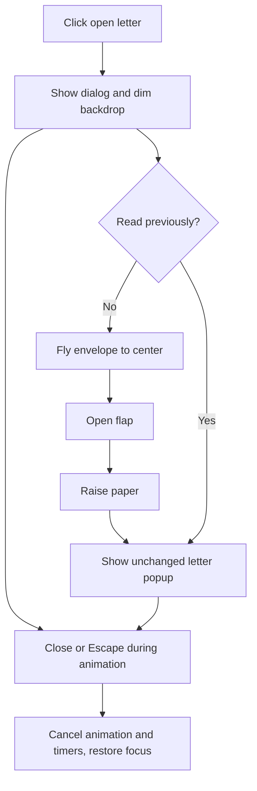

# Centered envelope and letter popup implementation plan

> Use superpowers:executing-plans to implement the approved scope inline.

**Goal:** Apply Be Vietnam Pro and Lora, then animate the envelope to the center before revealing the unchanged letter in a modal.

**Spec:** User approved the font pairing and sequence in chat on 2026-10-23.

**Architecture:** Native dialog outside the clipped page shell, matching the photo lightbox. Keep the source envelope in its card as a placeholder, animate a display copy in the modal with the Web Animations API, then reveal the single existing letter content. No dependency, environment or publishing changes.

## Steps

- [x] Back up existing affected files; preserve existing uncommitted work.
- [x] Update source-contract assertions and add runtime tests for animation sequencing, cancellation, reopening and reduced motion. Run and confirm failures.
- [x] Update index.html with an accessible dialog, close control and animation stage; move the original letter content into it without changing wording.
- [x] Implement 450 ms flight, 650 ms flap opening and 450 ms paper reveal, followed by the reading panel. Cancel pending work on close. Reopen completed letters directly.
- [x] Update scoped font and modal styles, responsive dimensions and reduced motion.
- [x] Run full tests, syntax and whitespace checks; verify desktop/mobile, closing mid-animation and reopening in browser.

## Flow

## Popup layout

Centered paper panel, close control at top right, Lora title and letter body; bounded height with internal scrolling on short/mobile screens. Initial envelope is centered in the same modal with the close control available throughout. Background page remains in place and is inert while the dialog is open.

## Verification record

- Backup: `C:/Users/CNTT-006/AppData/Local/Temp/miu-letter-20261023-141323/`.
- The three new runtime tests failed before implementation, then passed. Full suite: 17/17.
- Browser: both font families loaded; popup opens after the animation; Escape and backdrop close it and restore focus; reading again opens directly; Escape during flight restores the source and allows a fresh opening.
- Mobile emulation: no horizontal overflow at 390 and 320 CSS pixels. At 390 x 600 the reading panel scrolls internally to the last paragraph.
- Static review found no actionable correctness or accessibility issues. Physical-device and published-host checks were not performed. No commit, push or deploy.
