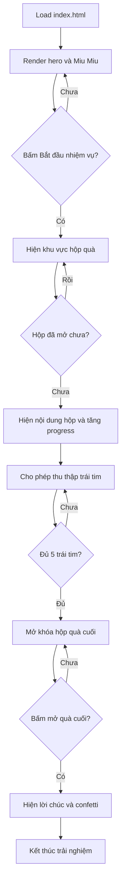

# Miu Miu gửi lời yêu - Design Spec

## 1. Mục tiêu

Xây dựng một landing page local-first dành riêng cho lời chúc 20/10 của người dùng gửi vợ. Trang phải tạo cảm giác như một món quà tương tác: dễ thương, vui vẻ, có chú mèo chibi trắng kem pha cam đeo nơ đỏ dẫn đường qua các kỷ niệm và mở khóa lời chúc cuối.

Thành công được đo bằng việc người nhận có thể mở trang trên điện thoại, hiểu ngay cách bắt đầu, tương tác qua một số bước ngắn và nhận được lời nhắn cuối mà không cần đăng nhập, backend, database hay tài khoản.

## 2. Đã chốt

- Tên concept: `Miu Miu gửi lời yêu`.
- Mascot: mèo trắng kem pha cam, đeo nơ đỏ, má hồng, đuôi cong hình trái tim.
- Không khí: cute, vui vẻ, ấm áp; không biến thành mini-game phức tạp.
- Primary device: mobile; desktop vẫn responsive.
- Ngôn ngữ: tiếng Việt.
- Triển khai: local trong repo `D:\prj-my\miu-miu-20-10`; chưa publish.
- Công nghệ: HTML, CSS, JavaScript module thuần; không thêm dependency runtime. Module runtime dùng đuôi `.js` để static server mặc định trả MIME JavaScript hợp lệ.
- Không autoplay audio; chưa có asset âm thanh được cung cấp.

## 3. Trải nghiệm người dùng

1. Màn hình mở đầu có Miu Miu vẫy tay, dòng chào và nút `Bắt đầu nhiệm vụ`.
2. Hero giải thích nhiệm vụ: mở khóa một món quà 20/10.
3. Ba hộp quà nhỏ lần lượt mở để hiện lời khen, kỷ niệm và lời cảm ơn. Mỗi hộp chỉ mở một lần và cập nhật tiến trình.
4. Khu vực kỷ niệm trình bày các thẻ ảnh/placeholder theo dạng polaroid. Nội dung mẫu phải được đánh dấu rõ để người dùng thay bằng ảnh và câu chuyện thật.
5. Người nhận thu thập tối đa năm trái tim; mỗi trái tim hiện một câu nhắn ngắn. Khi đủ 100%, hộp quà cuối được mở khóa.
6. Miu Miu mở hộp quà cuối, hiển thị lời chúc 20/10 và một lời mời quà thật có thể sửa trong cấu hình nội dung.

## 4. Luồng logic



## 5. Bố cục giao diện

```text
[Header nhỏ: Miu Miu gửi lời yêu]

[Hero]
  Miu Miu vẫy tay
  “Meo! Anh có một món quà bí mật muốn gửi đến em.”
  [Bắt đầu nhiệm vụ]

[Mission progress]
  Nhiệm vụ hôm nay: làm em mỉm cười
  Thanh tiến trình

[Gift cards]
  [Điều anh thích ở em] [Kỷ niệm] [Lời cảm ơn]

[Memory gallery]
  3 polaroid cards, nội dung có thể thay bằng ảnh thật

[Heart collection]
  5 trái tim tương tác
  Miu Miu phản hồi sau mỗi lần bấm

[Final gift]
  Hộp quà lớn
  Lời chúc 20/10
  Lời mời quà thật

[Footer]
  “Miu Miu đã hoàn thành nhiệm vụ.”
```

## 6. Visual system và animation

- Nền chính: `#FFF8F0`; card: `#FFF1DF`; cam: `#E9A05B`; nơ đỏ: `#D94F4F`; má hồng: `#F6B8B0`; chữ nâu: `#4A302B`; vàng nhấn: `#FFD66B`.
- Font dùng system stack rounded, không tải font bên ngoài.
- Radius lớn, shadow mềm, spacing rộng, nút có focus state rõ.
- Miu Miu idle: bob nhẹ, blink, đuôi sway.
- Hộp quà: shake trước khi mở, nắp bật bằng transform.
- Trái tim: float về thanh tiến trình khi thu thập.
- Cards: reveal on scroll bằng class CSS, không phụ thuộc thư viện animation.
- Final: confetti giới hạn số lượng, `prefers-reduced-motion` tắt chuyển động không cần thiết.

## 7. Ràng buộc và cảnh báo

- Không thêm login, API, database, form gửi mail, analytics hoặc persistence.
- Không dùng lời chứng thực, số liệu hay thông tin thực tế không được người dùng cung cấp.
- Ảnh/kỷ niệm sẽ dùng placeholder rõ ràng cho đến khi người dùng thay asset thật.
- Không autoplay nhạc vì trình duyệt có thể chặn và người nhận có thể đang mở trang ở nơi công cộng.
- Nếu sau này thêm ảnh thật, cần tối ưu kích thước ảnh để giữ tốc độ trên mobile.

## 8. Tiêu chí nghiệm thu

- Mở được bằng local server và hiển thị đúng ở viewport mobile và desktop.
- Nút bắt đầu chuyển được tới trạng thái nhiệm vụ.
- Mỗi hộp quà mở đúng một lần và cập nhật progress.
- Năm trái tim chỉ thu thập một lần; đủ năm trái tim mới mở khóa quà cuối.
- Hộp quà cuối hiển thị lời chúc và confetti.
- Các nút có trạng thái keyboard focus; nội dung quan trọng có semantic labels.
- `prefers-reduced-motion` không gây mất nội dung hoặc chức năng.
- `node --check`/test và `git diff --check` không có lỗi.
