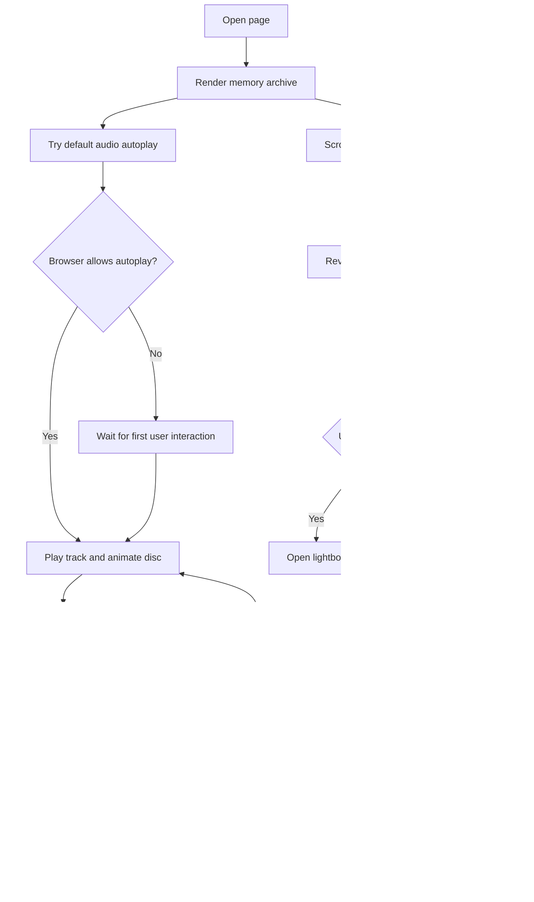

# Kho lưu trữ kỷ niệm — Design

## Intent

### Approved visual revision — 2026-10-23

User confirmed the supplied scrapbook reference as the visual direction. The
main page uses warm paper grain, serif typography, a real-photo Polaroid hero,
botanical SVG accents, a four-column desktop album and horizontal cards in a
single mobile column. The existing 12 photos, order, titles, captions, letter
wording and MP3 remain authoritative; illustrative dates and music from the
reference are not imported. Captions remain available in the photo lightbox.
The letter teaser places text left and the envelope right. The playlist keeps
the approved disc-triggered panel rather than adding a seek bar or pause control.
Existing character assets are preserved; the floating character is hidden on
the main scrapbook page and the couple illustration appears as a small stamp.

Sau khi sự kiện 20/10 kết thúc, trang chuyển từ một hành trình có nhiệm vụ sang
một trang lưu trữ để người nhận có thể quay lại xem các kỷ niệm bất kỳ lúc nào.
Trải nghiệm chính là lướt qua 12 ảnh, mở ảnh lớn khi muốn, chọn nhạc nền và mở
lá thư cuối trang.

## Goals

- Đổi ngôn ngữ và bố cục chính sang “Kho lưu trữ kỷ niệm”.
- Hiển thị 12 ảnh theo dạng album/timeline; ảnh xuất hiện dần khi cuộn.
- Không còn khóa phần, đếm lượt click, nhiệm vụ hoặc thông báo “món quà thật”.
- Giữ lightbox ảnh và khả năng xem lại ảnh theo thứ tự.
- Giữ phong thư cuối trang, animation mở thư và lời chúc cuối cùng đã được cung cấp.
- Giữ đĩa nhạc và nốt nhạc bay; thêm khung playlist có thể mở và chọn bài.
- Dùng bài `assets/audio/cham-em-mot-doi.mp3` làm mục playlist đầu tiên.
- Giữ responsive riêng cho desktop/mobile và không thêm dependency.

## Non-goals

- Không tạo hoặc tải thêm file âm thanh trong phiên này.
- Không tự thêm các bài hát giả chưa có file phát được.
- Không thay đổi ảnh kỷ niệm, ảnh nhân vật, social preview hoặc nội dung lời chúc
  ngoài phạm vi bố cục lưu trữ.
- Không deploy hoặc push Git trong phiên này nếu chưa có xác nhận riêng.
- Không đưa ảnh bổ sung vào lưới 12 ảnh của trang chính.

## Anti-goals

- Không giữ cảm giác người dùng phải “vượt nhiệm vụ” để xem nội dung.
- Không biến playlist thành một trình phát phức tạp có volume slider, seek bar
  hoặc nút tắt nhạc; phạm vi chỉ gồm bài hiện tại, mở danh sách, chọn bài,
  bài trước và bài tiếp theo.
- Không làm desktop và mobile dùng chung một bố cục co nhỏ thiếu kiểm soát.

## Approaches considered

1. **Kho lưu trữ tĩnh:** chỉ đổi nội dung và hiển thị toàn bộ ảnh.
   Dễ triển khai nhưng mất phần khám phá nhẹ và không tận dụng được animation
   đang có.
2. **Kho lưu trữ tương tác nhẹ — được chọn:** dùng hero lưu trữ, album 12 ảnh
   xuất hiện theo scroll, lightbox tùy chọn, phong thư luôn có thể mở và playlist
   dạng panel. Giữ cảm xúc và các cơ chế hiện có nhưng bỏ toàn bộ gating.
3. **Album cinematic toàn màn hình:** mỗi ảnh chiếm gần trọn viewport và có
   chuyển cảnh theo chương. Ấn tượng hơn nhưng khó xem nhanh trên mobile, dễ làm
   trang nặng và không phù hợp với mục tiêu lưu trữ lâu dài.

Phương án 2 được chọn vì cân bằng giữa cảm xúc, khả năng xem lại và phạm vi thay
đổi an toàn trên nền static HTML/CSS/JS hiện tại.

## Functional design

### Page structure

```text
Hero: Miu Miu / Kho lưu trữ kỷ niệm / Những ngày mình đã đi qua
  └─ ảnh mở đầu và lời dẫn ngắn

Memory archive: 12 kỷ niệm được lưu lại
  └─ 12 card ảnh, reveal theo IntersectionObserver
  └─ bấm card mở lightbox; không dùng click để mở khóa nội dung

Letter archive: Một lá thư để dành
  └─ phong thư đóng
  └─ nút Mở lá thư
  └─ animation nắp thư mở rồi hiển thị lời chúc

Music player
  └─ đĩa nhạc cố định góc trái dưới, nốt nhạc bay
  └─ bấm đĩa mở playlist panel
  └─ mục đầu tiên: Chăm Em Một Đời — assets/audio/cham-em-mot-doi.mp3
  └─ bài trước / bài tiếp theo giữ sẵn cho các file sẽ bổ sung sau

Extended archive page: `more-memories.html`
  └─ trang riêng để xem các ảnh bổ sung được push vào repo sau này
  └─ đọc danh sách từ `assets/memories-extra/manifest.js`
  └─ không tự upload hoặc ghi file vào repo từ trình duyệt
  └─ có empty state rõ ràng khi chưa có ảnh bổ sung
  └─ có đường dẫn từ trang chính sang archive mở rộng
```

### Playlist behavior

- `playlist` là một mảng cấu hình ở `app.js`; mỗi mục có `title`, `artist` và
  `src`.
- Phiên bản đầu chỉ có một mục hợp lệ, không hiển thị placeholder bài chưa có
  file.
- Chọn một mục sẽ cập nhật `audio.src`, tên bài đang phát, trạng thái mục đang
  chọn và gọi `play()`.
- Với một mục, bài trước/bài tiếp theo giữ nguyên bài hiện tại và không tạo lỗi.
- Autoplay vẫn được cấu hình trên audio. Nếu trình duyệt chặn autoplay có tiếng,
  lần tương tác đầu tiên sẽ thử phát lại.
- Không có nút tắt nhạc; playlist panel có nút đóng riêng, không làm dừng nhạc.

### Letter behavior

- Approved update on 2026-10-23: Be Vietnam Pro for body/buttons and Lora for
  headings/letter text, retaining the paper scrapbook colors and existing copy.
- “Mở lá thư” opens a native dialog with a dimmed backdrop. A display copy flies
  from the source card to the viewport center for 450 ms; the source keeps its
  space in the album layout.
- The flap opens for 650 ms, the paper rises for 450 ms, then the unchanged letter
  appears in a centered paper popup. Text scrolls inside the popup on small screens.
- Close button, backdrop click and Escape close the dialog, cancel pending work
  and restore focus. The button becomes “Đọc lại lá thư ♡” and reopens the text.
- Reduced motion skips the opening animation and shows the reading panel directly.

## Files and responsibilities

- `index.html`: thay cấu trúc hero, archive, letter và markup playlist; giữ các
  asset path hiện có.
- `styles.css`: style archive responsive, playlist panel, album reveal và letter
  animation; giữ scrollbar và reduced-motion support.
- `app.js`: bỏ luồng mission/gating khỏi khởi tạo trang; thêm playlist state,
  playlist selection, autoplay fallback và letter interaction.
- `more-memories.html`: trang archive mở rộng độc lập, hiển thị các ảnh bổ sung
  từ manifest tĩnh, không làm thay đổi 12 ảnh ở trang chính.
- `more-memories.js`: render manifest, mở lightbox ảnh bổ sung và xử lý empty
  state.
- `assets/memories-extra/manifest.js`: danh sách ảnh bổ sung; khởi tạo rỗng để
  người dùng thêm file và object metadata sau này rồi push lên repo.
- `src/interaction-state.mjs`: cập nhật các hàm state thuần nếu test cần mô hình
  playlist/letter mới; không mở rộng state cho những cơ chế đã bị loại bỏ.
- `tests/interaction-state.test.mjs`: thay các assertion về mission bằng contract
  archive, playlist markup, letter behavior và responsive hooks; giữ các test
  lightbox/state thuần còn phù hợp.
- `docs/superpowers/plans/`: implementation plan được tạo sau khi design này
  được duyệt.

## Accessibility and responsive requirements

- Playlist panel dùng button thật, tên bài có thể đọc bằng screen reader và có
  `aria-expanded`, `aria-current`/`aria-pressed` phù hợp.
- Album card vẫn có alt text và lightbox giữ focus/đóng bằng Escape như hiện tại.
- Mobile dùng một cột; desktop dùng grid/timeline rộng hơn; các nút playlist có
  vùng chạm đủ lớn.
- `prefers-reduced-motion: reduce` tắt hoặc rút ngắn reveal, đĩa quay, nốt nhạc
  và animation mở thư.

## Flow



## Verification target

- `npm test` passes with archive/playlist/letter assertions.
- `node --check app.js` passes.
- `git diff --check` passes.
- Static preview is checked at desktop and mobile widths; evidence will be
  reported separately from automated source tests.

## Extended archive contract

Trang chính giữ nguyên 12 ảnh trong `memoryPhotos`. Trang `more-memories.html`
đọc một mảng tĩnh từ `assets/memories-extra/manifest.js`, ví dụ:

```js
export const extraMemories = [
  {
    src: 'assets/memories-extra/13.jpg',
    title: 'Một ngày mình muốn nhớ thêm',
    caption: 'Ghi chú cho kỷ niệm bổ sung.',
    alt: 'Mô tả ảnh bổ sung',
  },
];
```

Khi chưa có mục nào, trang hiển thị hướng dẫn ngắn rằng ảnh bổ sung sẽ xuất hiện
sau khi được thêm vào manifest và push lên repo. Không có chức năng upload giả
hoặc nút lưu không thể thực hiện trên GitHub Pages.

## Open input for later extension

Khi có thêm MP3, chỉ cần bổ sung file vào `assets/audio/` và thêm object vào mảng
playlist; không cần đổi markup hoặc luồng tương tác.

## Resolved implementation calls

- Archive thay trực tiếp trang hiện tại tại URL GitHub Pages hiện có; không tạo
  route mới và không duy trì màn hình mission cũ.
- Dùng đúng 12 ảnh, thứ tự, caption và alt text đang có trong `index.html` và
  `app.js`; thay đổi chỉ nằm ở cách trình bày và điều kiện hiển thị.
- Source hiện không dùng `localStorage` hoặc `sessionStorage`, nên không có trạng
  thái mission cũ cần migrate hoặc xóa khi chuyển sang archive.

Builder check: không còn câu hỏi quan trọng cần người dùng trả lời trước khi lập
implementation plan.
